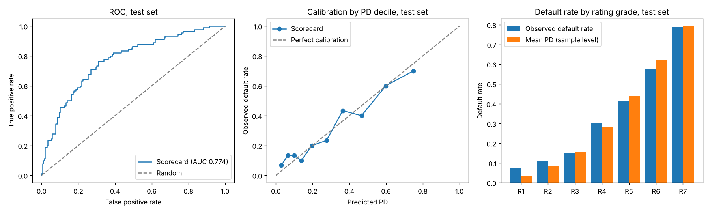

# Credit Risk PD Scorecard


A probability-of-default (PD) model built the way retail credit scorecards are built in banks and rating
agencies: **Weight-of-Evidence binning → Information Value screening → logistic regression → points
scaling → calibration to a long-run central tendency → rating master scale → validation**.
A gradient-boosting model is trained alongside as a challenger.

**Study guide:** [docs/STUDY_GUIDE.md](docs/STUDY_GUIDE.md) explains every concept and decision.

## Results (German Credit, 70/30 stratified split)

| Metric | Scorecard (logistic, 9 features) | Challenger (gradient boosting, 18 features) |
|---|---|---|
| 5-fold CV Gini (train) | 0.499 ± 0.039 | 0.537 ± 0.034 |
| Test Gini | **0.547** (95 % bootstrap CI 0.43–0.65) | 0.596 |
| Test AUC | 0.774 | 0.798 |
| Test KS | 0.457 | – |
| Brier score | 0.168 | – |
| Hosmer–Lemeshow p-value | 0.61 (no evidence of miscalibration) | – |
| PSI train vs. test | 0.013 (stable) | – |

The challenger is ~0.05 Gini stronger but is a black box with 18 inputs; the scorecard is fully
explainable (points per bin), uses 9 inputs with significant, correctly signed coefficients, and stays
within the challenger's confidence band. That trade-off is the usual reason scorecards stay in production.



### Rating master scale (test set)

PDs are calibrated to a **5 % long-run central tendency** (the German Credit sample over-represents
defaults at 30 %), mapped to 7 grades, and back-tested at sample level with a one-sided binomial test:

| Grade | PD upper bound | n | Defaults | Mean PD (sample) | Observed DR | Binomial p |
|---|---|---|---|---|---|---|
| R1 | 0.5 % | 41 | 3 | 3.5 % | 7.3 % | 0.18 |
| R2 | 1 % | 45 | 5 | 8.7 % | 11.1 % | 0.35 |
| R3 | 2 % | 54 | 8 | 15.5 % | 14.8 % | 0.61 |
| R4 | 4 % | 53 | 16 | 27.9 % | 30.2 % | 0.41 |
| R5 | 8 % | 48 | 20 | 43.9 % | 41.7 % | 0.68 |
| R6 | 16 % | 40 | 23 | 62.2 % | 57.5 % | 0.78 |
| R7 | 100 % | 19 | 15 | 79.1 % | 79.0 % | 0.64 |

Observed default rates rise monotonically across grades and no grade fails the binomial test at 5 %.

## Pipeline

| Stage | What it does | Code |
|---|---|---|
| Data | Encodes target (bad = 1), rejects missing values or unknown labels, **drops sex/marital status and nationality** on fairness grounds | `data.py` |
| WoE binning | Numeric: quantile bins merged until each holds ≥ 5 % and the bad rate is **monotonic**. Categorical: rare categories merged by nearest bad rate. Laplace-smoothed WoE = ln(%bad / %good) | `binning.py` |
| Feature selection | IV ≥ 0.02, then drop the weaker of any WoE pair with \|corr\| > 0.7 | `model.py` |
| Logistic regression | **statsmodels** Logit with backward elimination: drop p > 0.05 or wrong-signed coefficients | `model.py` |
| Scaling | 600 points at 50:1 good:bad odds, 20 points to double the odds (PDO); points table per bin | `model.py` |
| Calibration | Intercept shift (Brent root-finding) so mean PD = central tendency; rank order and Gini unchanged | `calibration.py` |
| Rating scale | 7-grade master scale, per-grade binomial test, monotonicity check | `calibration.py` |
| Validation | Gini, AUC, KS, Brier, Hosmer–Lemeshow, PSI, bootstrap CI; **whole pipeline refit inside each CV fold** to avoid binning leakage | `metrics.py`, `train.py` |
| Challenger | scikit-learn HistGradientBoosting with native categorical support | `train.py` |
| Tests / CI | 18 pytest tests; GitHub Actions runs ruff, pytest and a full training run | `tests/`, `.github/` |

## Selected features and Information Value

| Feature | IV | | Feature | IV |
|---|---|---|---|---|
| Checking account status | 0.630 | | Employment since | 0.139 |
| Credit history | 0.251 | | Purpose | 0.130 |
| Savings | 0.221 | | Other instalment plans | 0.118 |
| Duration (months) | 0.200 | | Housing | 0.103 |
| | | | Instalment rate (% of income) | 0.033 |

Dropped with reasons (low IV, p-value, sign) are recorded in `reports/results.json`; the full
points table is in `reports/scorecard_points.csv`.

## Quick start

```bash
python -m venv .venv && source .venv/bin/activate
pip install -e ".[dev]"
pytest            # 18 tests
pd-train          # writes reports/
```

## Data

*Statlog (German Credit Data)*, UCI Machine Learning Repository (Hofmann, 1994), CC BY 4.0.
1,000 loans, 20 attributes, 30 % defaults. The CSV with readable category labels is in `data/`.

## Limitations and next steps

- No application dates, so out-of-time validation is not possible; on real data the test set would be
  the most recent vintage.
- Small sample (300 defaults) gives wide confidence intervals; the bootstrap CI is reported for that reason.
- Next: Basel IRB risk weight from PD (with LGD/EAD assumptions), reject inference, isotonic calibration
  comparison, and SHAP explanations for the challenger.
